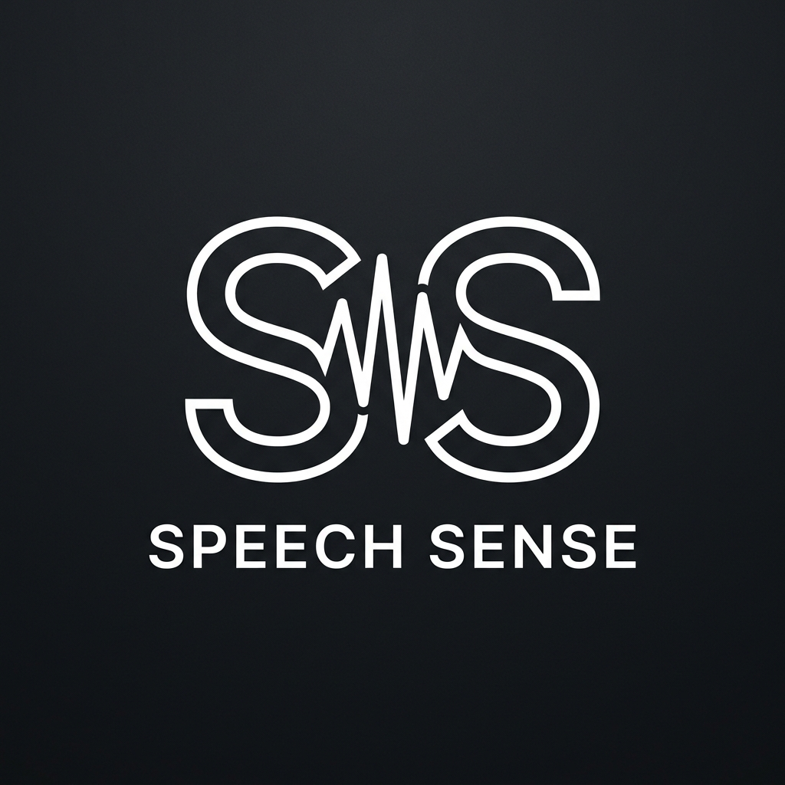
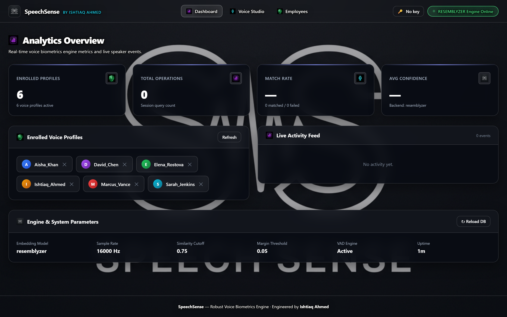
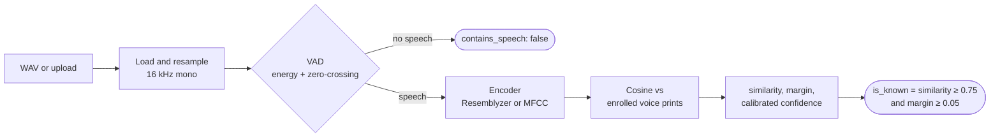
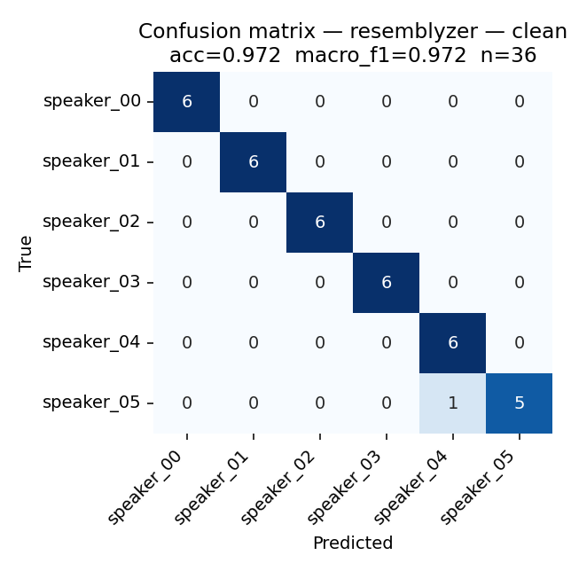
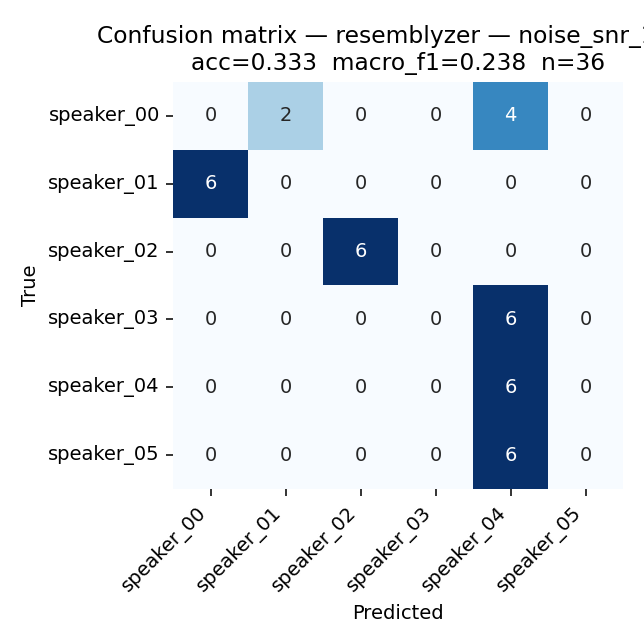

<div align="center">



# robust-voice-recognition

**Who is speaking? Speaker enrollment, identification and verification with a REST API, a browser dashboard and an offline fallback.**


[](LICENSE)

[Overview](#overview) ·
[Features](#features) ·
[Installation](#installation) ·
[Usage](#usage) ·
[Configuration](#configuration) ·
[Results](#results) ·
[Project layout](#project-layout) ·
[License](#license)

</div>

---

This repository holds `speech_sense`, a Python package that recognises **who** is talking, not **what** they say.
You enroll a person from one to three short clips, and from then on it can tell you whether a new clip belongs to
them. It runs from a CLI, a FastAPI service, a three-page browser dashboard or plain Python. Embeddings come from
[Resemblyzer](https://github.com/resemble-ai/Resemblyzer) (GE2E, 256-dimensional unit vectors). When that model
cannot load, an MFCC fallback takes over, so the pipeline and the full test suite still run on a machine with no
model download.

<p align="center">
  
</p>

<p align="center">
  <sub>The dashboard at <code>http://127.0.0.1:8000</code> after <code>speech-sense serve</code>. The other two pages:
  <a href="docs/screenshots/studio.png">Voice Studio</a> for recording and verification, and
  <a href="docs/screenshots/employees.png">Employees</a> for one-click enrollment of the <code>employees_audio/</code> roster.</sub>
</p>

## Overview

| Operation | Input | Output |
|---|---|---|
| **Enroll** | A name and 1 to 3 WAV clips | One voice print: the mean of the clip embeddings |
| **Identify** | A clip | The closest enrolled speaker, with similarity, margin, confidence and `is_known` |
| **Verify** | A clip and a claimed name | Match or no match against that speaker (CLI exit code 0 on a match) |

### How it works



Every result carries more than a single score:

| Field | Range | Meaning |
|---|---|---|
| `similarity` | `-1..1` | Cosine between the query embedding and the winning speaker |
| `margin` | `0..2` | Gap between the winner and the second-best speaker. A small margin means ambiguous |
| `confidence` | `0..1` | Sigmoid over similarity and margin. High similarity with a low margin (the twin case) gives a moderate value, not a high one |
| `is_known` | bool | `similarity ≥ similarity_threshold` **and** `margin ≥ known_speaker_margin` |
| `contains_speech` | bool | VAD verdict on the input. A silent clip never claims a speaker |

## Features

| Area | What you get |
|---|---|
| Core | Enrollment, identification and 1-to-1 verification |
| Silence handling | Energy and zero-crossing VAD trims silence and rejects empty audio before inference |
| Scoring | Confidence calibrated from cosine similarity plus the margin over the runner-up |
| Evaluation | Speaker-disjoint enroll/test split, confusion matrix, per-class F1, noise sweep at chosen SNRs |
| Interfaces | CLI (`speech-sense`), FastAPI service, browser dashboard, streaming identifier, Python API |
| Scale | Parallel batch enrollment and identification over a directory tree with a process pool |
| Backends | `auto`, `resemblyzer` or `mfcc`; `auto` falls back to MFCC on any load failure. Optional ONNX export |
| Security | Data-only `.npz` database read with `allow_pickle=False`, optional API key compared in constant time, upload size, duration and file-count caps, security headers, capped score lists |
| Operations | Inference off the event loop, atomic writes, corrupt-database quarantine, `/healthz` and `/readyz`, request ids in logs and headers |
| Config | One `Config` dataclass; every field can be overridden by a validated `SPEECH_SENSE_*` variable |

## Installation

Requires Python 3.10 or newer.

```bash
git clone https://github.com/ishtiaq-ahmed-dev/robust-voice-recognition.git
cd robust-voice-recognition
python -m venv .venv
# Windows:      .venv\Scripts\activate
# macOS/Linux:  source .venv/bin/activate

pip install -e ".[model,api,dev]"
```

| Extra | Installs | Why |
|---|---|---|
| `model` | `resemblyzer>=0.1.4` (pulls in PyTorch) | Real speaker embeddings |
| `api` | `fastapi`, `uvicorn[standard]`, `python-multipart` | REST service and dashboard |
| `dev` | `pytest`, `pytest-cov`, `httpx`, `onnxruntime` | Tests and ONNX checks |
| `mic` | `sounddevice` | Recording from the CLI |

`requirements.txt` (core plus `model` and `api`) and `requirements-dev.txt` (that plus `dev`) are there if you prefer
plain `pip install -r`. Without Resemblyzer everything still runs on the MFCC fallback; you get a warning on stderr
and lower accuracy on real speech.

## Usage

### Dashboard

```bash
speech-sense serve            # http://127.0.0.1:8000
```

This is the easiest way to try it. Three pages, served as plain `index.html`, `styles.css` and `app.js` with no build
step and no CDN:

- **Dashboard:** stat cards (speakers, operations, match rate, average confidence), enrolled profiles with delete,
  an activity feed and the engine settings.
- **Voice Studio:** six recording prompts to read aloud, microphone capture with a live waveform, identify and
  three-take enroll modes, drag-and-drop WAV upload, and a ranked score panel.
- **Employees:** the `employees_audio/` directory with clip counts and an "Enroll All Employees" button.

The recorder converts the browser's WebM/Opus to 16-bit PCM WAV before upload, so the server never needs ffmpeg.
Microphone capture needs a secure context (HTTPS or `localhost`); file upload works anywhere.

### CLI

```bash
speech-sense enroll --name alice --audio alice_1.wav alice_2.wav alice_3.wav
speech-sense identify --audio question.wav
#   {"speaker": "alice", "is_known": true, "similarity": 0.87, "margin": 0.14, "confidence": 0.94, ...}
speech-sense verify --name alice --audio question.wav     # exit code 0 on a match
speech-sense list
speech-sense delete --name alice

speech-sense serve --host 127.0.0.1 --port 8000
speech-sense evaluate --out reports/ --speakers 6 --clips 6 --snr 20 10 5
speech-sense benchmark --seconds 3 --iterations 20
speech-sense record --duration 5 --out clip.wav           # needs the [mic] extra
speech-sense repl                                         # interactive record / enroll / identify loop
```

Global options go before the subcommand: `--database` (default `speakers.npz`), `--backend auto|resemblyzer|mfcc`
and `--log-level`. Every command also works as `python -m speech_sense ...`. Expected failures such as a missing file
or an unknown speaker print one line and exit non-zero; `--log-level DEBUG` adds the traceback.

### Batch over a directory

Put one folder per speaker:

```text
dataset/
├── alice/
│   ├── take_001.wav
│   └── take_002.wav
└── bob/
    └── ...
```

```bash
speech-sense batch-enroll --dataset ./dataset --workers 8
speech-sense batch-identify --directory ./queries --out results.json   # or --audio a.wav b.wav
```

Workers default to `SPEECH_SENSE_WORKERS`, or CPU count minus one. Progress goes to stderr and results are JSON on
stdout or in `--out`. A bad clip is logged as `skipped` and the run carries on; if no process pool can be created,
the job finishes serially.

### REST API

```bash
speech-sense serve --host 0.0.0.0 --port 8000
```

Interactive docs live at `/docs` and the dashboard at `/`.

| Method | Endpoint | Key | Body / notes |
|---|---|:---:|---|
| GET | `/healthz` | | Liveness and backend info; 503 when degraded |
| GET | `/readyz` | | Is the encoder loaded? |
| GET | `/prompts` | | Recording sentences for the studio |
| GET | `/speakers` | yes | Enrolled names |
| GET | `/analytics` | yes | Dashboard metrics and activity feed |
| GET | `/employees` | yes | `employees_audio/` listing |
| DELETE | `/speakers/{name}` | yes | |
| POST | `/enroll` | yes | `name`, `files` (multipart) |
| POST | `/identify` | yes | `file` (multipart) |
| POST | `/verify` | yes | `name`, `file` (multipart) |
| POST | `/employees/enroll-all` | yes | Batch-enrolls the employee folder; 409 if a run is in progress |
| POST | `/batch/enroll` | yes | `name`, `files`; bad clips are skipped |
| POST | `/batch/identify` | yes | `files`; one row per file, order kept |
| POST | `/reload` | yes | Re-reads the database from disk |

Routes marked **yes** need an `X-API-Key` header, but only when `SPEECH_SENSE_API_KEY` is set. Without it the
service is open, which suits a local demo and nothing else; `speech-sense serve` prints a warning when you bind to a
non-loopback address with no key. The probe routes stay open so an orchestrator can tell a locked service from a dead
one.

```bash
curl -F "name=alice" -F "files=@alice_1.wav" -F "files=@alice_2.wav" http://localhost:8000/enroll
curl -F "file=@question.wav" http://localhost:8000/identify
```

### Python

```python
from speech_sense import SpeakerVerifier, SpeakerDatabase
from speech_sense.audio import load_wav

verifier = SpeakerVerifier(database=SpeakerDatabase.load("speakers.npz"))
verifier.enroll_from_files("alice", ["alice_1.wav", "alice_2.wav"])
verifier.database.save("speakers.npz")

result = verifier.identify(load_wav("question.wav"))
print(result.to_dict())
```

### Streaming

```python
from speech_sense import SpeakerVerifier
from speech_sense.streaming import StreamingIdentifier, iter_file_chunks
from speech_sense.audio import load_wav
from speech_sense.config import DEFAULT

stream = StreamingIdentifier(
    verifier=SpeakerVerifier(),
    on_event=lambda e: print(f"{e.t_seconds:.1f}s  {e.result.to_dict()}"),
)
for chunk in iter_file_chunks(load_wav("long.wav"), DEFAULT.sample_rate // 2):
    stream.process_chunk(chunk)
```

### ONNX export

```bash
python scripts/export_onnx.py --out models/voice_encoder.onnx --opset 17
```

## Configuration

Defaults live in `src/speech_sense/config.py`. Pass a `Config` to override per instance, or set
`SPEECH_SENSE_<FIELD_NAME>` to override globally.

```bash
export SPEECH_SENSE_SIMILARITY_THRESHOLD=0.82
export SPEECH_SENSE_WORKERS=16
export SPEECH_SENSE_DATABASE_PATH=/data/voice_prints.npz
export SPEECH_SENSE_API_KEY=$(openssl rand -hex 32)   # needed off localhost
speech-sense serve --host 0.0.0.0
```

| Variable | Default | Effect |
|---|---|---|
| `SPEECH_SENSE_SIMILARITY_THRESHOLD` | `0.75` | Minimum cosine for `is_known` |
| `SPEECH_SENSE_KNOWN_SPEAKER_MARGIN` | `0.05` | Minimum gap over the runner-up |
| `SPEECH_SENSE_TOP_K_SCORES` | `10` | Speakers listed per result |
| `SPEECH_SENSE_SAMPLE_RATE` | `16000` | Working sample rate |
| `SPEECH_SENSE_WORKERS` | CPU count - 1 | Batch worker processes |
| `SPEECH_SENSE_MAX_UPLOAD_BYTES` | 25 MiB | Per-file upload cap |
| `SPEECH_SENSE_MAX_AUDIO_SECONDS` | `600` | Cap on decoded duration |
| `SPEECH_SENSE_MAX_FILES_PER_REQUEST` | `25` | Files per request |
| `SPEECH_SENSE_API_KEY` | empty | Turns on the `X-API-Key` check |
| `SPEECH_SENSE_CORS_ORIGINS` | empty | CORS stays off unless you list origins |
| `SPEECH_SENSE_DATABASE_PATH` | `speakers.npz` | Voice-print database |
| `SPEECH_SENSE_EMPLOYEES_AUDIO` | `employees_audio` | Folder used by the Employees page |
| `SPEECH_SENSE_LOG_LEVEL` | `INFO` | Logging level |

The full field list, including the VAD, streaming and batch settings, is the `Config` dataclass. Environment
variables are treated as untrusted: a value that does not parse or is out of range is ignored with a `WARNING` and
the default is used, so a typo cannot crash-loop a service. The same bad value passed to `Config(...)` in code raises.

### Running it as a service

| Concern | Behaviour |
|---|---|
| Blocking work | Embedding calls go through `run_in_threadpool`, so one inference does not stall other connections |
| Request limits | Byte cap per file, file cap per request, and a cap on **decoded** duration |
| Startup failure | If the encoder cannot load, `/healthz` still answers with 503 and the reason |
| Errors | A global handler logs the exception with a request id and returns only that id |
| Durability | Writes go to a temp file and `os.replace`; a corrupt file is moved to `<path>.corrupt-<ts>` and the service starts empty |
| Concurrency | The speaker database is guarded by a lock |
| Headers | `X-Request-ID`, `X-Content-Type-Options`, `X-Frame-Options`, `Referrer-Policy` on every response |

## Results

All numbers below come from the built-in synthetic dataset and speaker-disjoint split (6 speakers, 2 clips to enroll
and 6 to test per speaker, seed 42). Reproduce them with:

```bash
speech-sense --backend resemblyzer evaluate --out reports/ --speakers 6 --clips 8
speech-sense --backend mfcc evaluate --out reports/ --speakers 6 --clips 8
```

| Backend | Condition | Accuracy | Macro-F1 |
|---|---|---|---|
| **Resemblyzer** | clean | **0.972** | **0.972** |
| Resemblyzer | white noise, 20 dB SNR | 0.833 | 0.778 |
| Resemblyzer | white noise, 10 dB SNR | 0.333 | 0.238 |
| Resemblyzer | white noise, 5 dB SNR | 0.194 | 0.098 |
| **MFCC fallback** | clean | 1.000 | 1.000 |
| MFCC fallback | white noise, 20 dB SNR | 1.000 | 1.000 |
| MFCC fallback | white noise, 10 dB SNR | 0.472 | 0.337 |
| MFCC fallback | white noise, 5 dB SNR | 0.250 | 0.131 |

**How to read this.** The synthetic speakers are harmonic tones with per-speaker formant shifts, which is what lets the
project ship without a dataset. Resemblyzer was trained on real speech, so tones under noise are a poor fit for it.
The MFCC fallback looks better here only because the synthetic signals are close in cepstral space; on real audio the
order flips, which is why Resemblyzer is the default. For GE2E results on real speech, see the
[GE2E paper](https://arxiv.org/abs/1710.10467).

<p align="center">
  
  
</p>

### Benchmark

`speech-sense benchmark` on 3-second clips, batch size 1, on the author's PC. Expect different numbers on other
hardware.

| Backend | Median latency | p95 latency | Throughput | Real-time factor | Model size |
|---|---:|---:|---:|---:|---:|
| Resemblyzer | 15.9 ms | 16.9 ms | 62.8 clips/s | 0.005 (about 200x real time) | 5.4 MB |
| MFCC | 2.8 ms | 3.3 ms | 356.1 clips/s | 0.001 (about 1000x real time) | n/a |

### Tests

```bash
pytest -q
```

152 tests: 151 run by default and one parallel-mode smoke test runs when `SPEECH_SENSE_TEST_PARALLEL=1` is set. They
cover config validation, audio I/O and resampling, VAD, the database (atomic writes, quarantine, name checks), the
verifier, streaming, the speaker-disjoint split, every API route, batch error isolation, the CLI, and one regression
test per hardening fix. Synthetic speakers are seeded with `zlib.crc32` rather than `hash()`, so the voices are the
same on every run and the suite needs no downloads.

## Project layout

```text
robust-voice-recognition/
├── src/speech_sense/
│   ├── config.py          Config dataclass and validated env overrides
│   ├── audio.py           I/O, resampling, noise injection, framing
│   ├── vad.py             voice activity detection
│   ├── embedding.py       Resemblyzer and MFCC encoders
│   ├── database.py        speaker database, atomic .npz persistence
│   ├── verifier.py        enroll / identify / verify
│   ├── batch.py           parallel batch enroll and identify
│   ├── streaming.py       chunked near-real-time identification
│   ├── evaluate.py        speaker-disjoint split, metrics, plots
│   ├── benchmark.py       latency, real-time factor, model size
│   ├── api.py             FastAPI service
│   ├── cli.py             speech-sense CLI
│   ├── __main__.py        python -m speech_sense
│   └── web/               dashboard: index.html, styles.css, app.js, assets/
├── tests/                 pytest suite (synthetic speakers in conftest.py)
├── scripts/
│   ├── generate_employee_dataset.py   rebuilds employees_audio/ deterministically
│   └── export_onnx.py                 exports the Resemblyzer encoder to ONNX
├── employees_audio/       synthetic sample corpus: 6 people, 3 takes each
├── data/                  place for your own corpora (see data/README.md)
├── docs/                  screenshots and evaluation figures
├── pyproject.toml
├── requirements.txt
└── requirements-dev.txt
```

## Design notes

- **VAD is peak-relative.** A frame counts as speech when its RMS clears a fraction of the loudest frame plus a small
  absolute floor. An earlier percentile-based rule returned "silence" for clips recorded at a steady level. Swapping in
  Silero-VAD only means replacing the per-frame decision array.
- **`.npz`, never pickle.** A tampered database file cannot run code. Legacy `.pkl` support was removed for that reason.
- **One embedding size per database.** Mixing backends is refused at write time and reported clearly at read time,
  instead of every `/identify` failing with a 500.
- **Capped score lists.** A result lists the top `SPEECH_SENSE_TOP_K_SCORES` speakers, so one request cannot dump the
  whole roster.
- **Streaming is single-threaded.** Fine at microphone rates.

## Limitations

- **Small enrollment set.** One to three clips is a starting point; voice prints stabilise around 5 to 10.
- **One global threshold.** `0.75` suits Resemblyzer's unit sphere but should be tuned on your own data. There is no
  per-speaker calibration yet.
- **Closed-set identification.** `identify()` returns the best match plus `is_known`; there is no score normalisation
  (such as AS-Norm) for unseen speakers.
- **Energy-based VAD.** Loud music or noise can pass as speech.
- **Synthetic evaluation only.** Real speech will give different numbers. To measure real EER, use
  [VoxCeleb1-O](https://www.robots.ox.ac.uk/~vgg/data/voxceleb/vox1.html) or LibriSpeech dev-clean.
- **No liveness check.** A good recording of an enrolled speaker will pass.

## Roadmap

- Silero VAD backend
- Per-speaker thresholds from held-out data
- Open-set rejection with score normalisation
- VoxCeleb1-O evaluation script
- Docker image for the API
- Liveness / anti-spoofing

## About the sample data

`employees_audio/` holds **synthetic** audio made by `scripts/generate_employee_dataset.py`. No real person is
recorded and the output is reproducible. Real recordings, and the `speakers.npz` voice prints made from them, are
biometric data: keep them out of version control (the repository has no `.gitignore`, so check before you commit) and
point `SPEECH_SENSE_EMPLOYEES_AUDIO` at a folder outside the repository.

## License

MIT. See [LICENSE](LICENSE).

## Author

**Ishtiaq Ahmed** · GitHub [@ishtiaq-ahmed-dev](https://github.com/ishtiaq-ahmed-dev)
